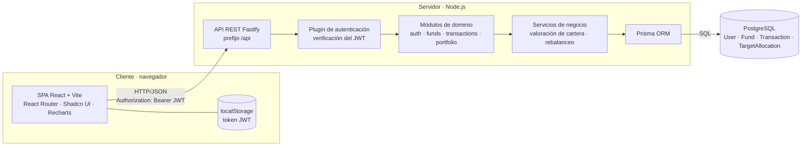
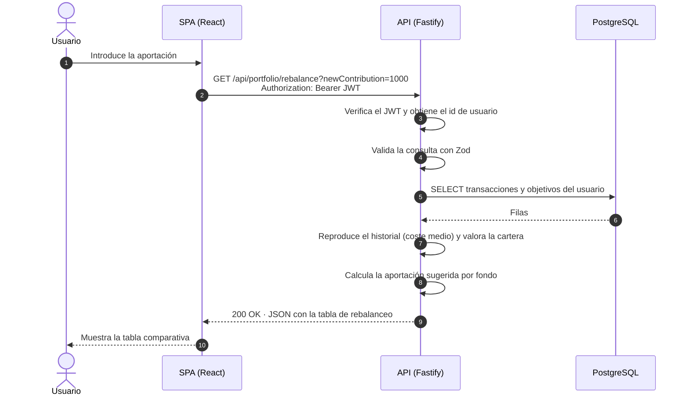
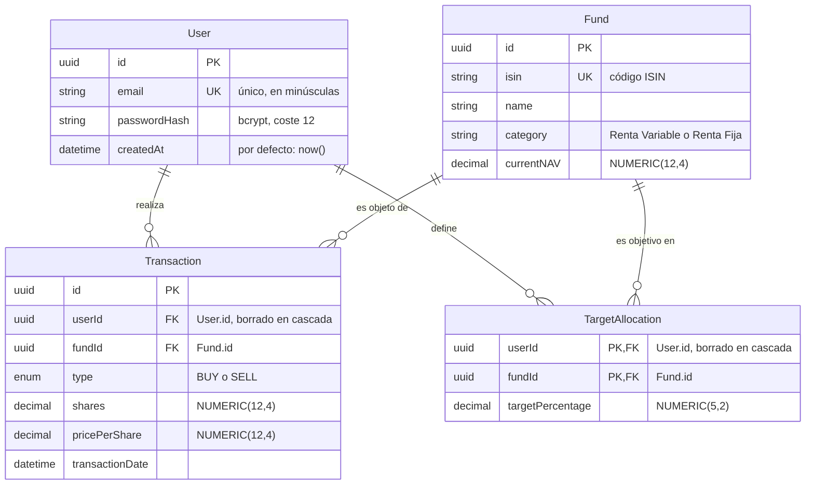

# Documentación técnica: Gestor de Carteras de Fondos Indexados

Este documento describe la arquitectura, el modelo de datos, la interfaz de programación (API REST) y el algoritmo de rebalanceo del sistema. Está redactado para su incorporación a la memoria del Trabajo Fin de Máster. Para la instalación y el uso de la aplicación, consúltese el [`README.md`](./README.md).

**Índice**

1. [Arquitectura del sistema](#1-arquitectura-del-sistema)
2. [Esquema de base de datos](#2-esquema-de-base-de-datos)
3. [Especificación de la API REST](#3-especificación-de-la-api-rest)
4. [Algoritmo de rebalanceo](#4-algoritmo-de-rebalanceo)
5. [Limitaciones y trabajo futuro](#5-limitaciones-y-trabajo-futuro)

---

## 1. Arquitectura del sistema

### 1.1 Visión general

El sistema sigue una arquitectura **cliente-servidor de tres capas**, con una separación estricta entre presentación, lógica de negocio y persistencia:

1. **Capa de presentación.** Una aplicación de página única (*Single Page Application*, SPA) desarrollada con React y Vite. Se ejecuta íntegramente en el navegador, gestiona la navegación en el cliente y consume la API mediante peticiones HTTP con cuerpo JSON.
2. **Capa de aplicación.** Un servidor Node.js basado en Fastify que expone una API REST sin estado. Valida los datos de entrada, autentica a los usuarios mediante tokens JWT, aplica las reglas de negocio y accede a la base de datos a través del ORM Prisma.
3. **Capa de persistencia.** Una base de datos relacional PostgreSQL que garantiza la integridad de los datos mediante claves, restricciones de unicidad y tipos numéricos de precisión exacta.

El código fuente se organiza como un **monorepo** con dos proyectos independientes (`backend/` y `frontend/`) que comparten únicamente el contrato de la API, definido en la sección 3.

### 1.2 Diagrama de arquitectura



### 1.3 Responsabilidades por componente

| Componente | Tecnología | Responsabilidad |
|---|---|---|
| **SPA** | React 19, Vite, TypeScript | Interfaz de usuario, enrutado, formularios, gráficos y estado de sesión. Calcula en el cliente la vista previa del rebalanceo para responder de forma instantánea a cambios no guardados. |
| **Estilos y componentes** | Tailwind CSS 4, Shadcn UI | Sistema de diseño accesible y consistente (botones, tablas, diálogos, selectores). |
| **API REST** | Fastify 5 | Enrutado, serialización JSON, gestión de errores y ciclo de vida de la petición. |
| **Validación** | Zod 4 | Validación y normalización de todas las entradas antes de llegar a la lógica de negocio. |
| **Autenticación** | `@fastify/jwt`, `bcryptjs` | Emisión y verificación de JWT; cifrado de contraseñas. |
| **Servicios** | TypeScript | Reglas de negocio: coste medio, valoración de la cartera y cálculo de rebalanceo. |
| **Acceso a datos** | Prisma 7 | Modelo tipado, consultas, transacciones de base de datos y migraciones. |
| **Base de datos** | PostgreSQL 17 | Almacenamiento persistente con integridad referencial. |

### 1.4 Flujo de una petición: consulta de rebalanceo



### 1.5 Decisiones de diseño relevantes

- **Autenticación sin estado (JWT).** El servidor no almacena sesiones: cada petición lleva un token firmado (HS256) con el identificador y el email del usuario, y caducidad configurable (7 días por defecto). Esto simplifica el escalado horizontal. Las contraseñas se almacenan con **bcrypt** (coste 12) y la API responde igual ante un usuario inexistente y ante una contraseña incorrecta, para no revelar qué emails están registrados.
- **Aritmética decimal exacta.** Los importes, precios y participaciones se almacenan como `NUMERIC` en PostgreSQL y se procesan en el servidor con la clase `Decimal` de Prisma (basada en `decimal.js`). Se evita así el error de representación de la coma flotante binaria. El redondeo se realiza únicamente al serializar la respuesta.
- **Validación en el borde.** Cada ruta valida su entrada con un esquema Zod antes de ejecutar lógica alguna. Los errores de validación se devuelven con un formato uniforme (sección 3.1).
- **Integridad ante concurrencia.** Al registrar una venta, el servidor bloquea la fila del usuario (`SELECT … FOR UPDATE`) dentro de una transacción de base de datos y reproduce el historial del fondo afectado. Esto impide que dos peticiones simultáneas vendan las mismas participaciones y que una operación con fecha pasada deje el historial incoherente.
- **Modularidad.** Cada dominio (`auth`, `funds`, `transactions`, `portfolio`) agrupa sus rutas, esquemas de validación y tipos de datos. Los cálculos de negocio residen en funciones puras (`portfolio.calc`, `rebalance.service`), lo que permite probarlos sin base de datos.
- **Cálculo del rebalanceo en dos lugares.** El servidor expone el cálculo por API (fuente de verdad documentada en esta memoria) y el cliente incorpora una implementación equivalente para ofrecer una vista previa inmediata mientras el usuario edita objetivos sin guardar. Ambas implementaciones están cubiertas por pruebas.
- **Pruebas.** Se emplea Vitest en ambos proyectos. El backend se prueba con una base de datos simulada en memoria y el frontend con React Testing Library, simulando las respuestas de la API; ninguna prueba requiere servicios externos.

---

## 2. Esquema de base de datos

### 2.1 Diagrama entidad-relación



### 2.2 Descripción de las entidades

**`User`**: usuario registrado en el sistema.

| Campo | Tipo | Restricciones | Descripción |
|---|---|---|---|
| `id` | UUID | Clave primaria | Identificador generado automáticamente. |
| `email` | Texto | Único | Correo electrónico, normalizado a minúsculas. |
| `passwordHash` | Texto | — | Contraseña cifrada con bcrypt. |
| `createdAt` | Fecha y hora | Por defecto `now()` | Fecha de alta. |

**`Fund`**: fondo indexado del catálogo.

| Campo | Tipo | Restricciones | Descripción |
|---|---|---|---|
| `id` | UUID | Clave primaria | Identificador. |
| `isin` | Texto | Único | Código ISIN internacional del fondo. |
| `name` | Texto | — | Denominación del fondo. |
| `category` | Texto | — | Categoría de activo (por ejemplo, *Renta Variable*, *Renta Fija*). |
| `currentNAV` | `NUMERIC(12,4)` | — | Valor liquidativo (*Net Asset Value*) actual por participación, en euros. |

**`Transaction`**: operación de compra o venta de participaciones.

| Campo | Tipo | Restricciones | Descripción |
|---|---|---|---|
| `id` | UUID | Clave primaria | Identificador. |
| `userId` | UUID | Clave foránea → `User`; borrado en cascada | Propietario de la operación. |
| `fundId` | UUID | Clave foránea → `Fund` | Fondo operado. |
| `type` | Enumerado | `BUY` o `SELL` | Tipo de operación. |
| `shares` | `NUMERIC(12,4)` | — | Número de participaciones (hasta 4 decimales). |
| `pricePerShare` | `NUMERIC(12,4)` | — | Precio por participación en la operación. |
| `transactionDate` | Fecha y hora | — | Fecha efectiva de la operación. |

Índices: `(userId, transactionDate)`, para recuperar el historial ordenado de un usuario, y `(fundId)`.

**`TargetAllocation`**: porcentaje objetivo de un fondo en la cartera de un usuario.

| Campo | Tipo | Restricciones | Descripción |
|---|---|---|---|
| `userId` | UUID | Clave primaria compuesta; clave foránea → `User`; borrado en cascada | Usuario. |
| `fundId` | UUID | Clave primaria compuesta; clave foránea → `Fund` | Fondo. |
| `targetPercentage` | `NUMERIC(5,2)` | — | Porcentaje objetivo (0-100, dos decimales). |

### 2.3 Cardinalidades y reglas de integridad

- Un **usuario** puede tener muchas **transacciones** y muchos **objetivos**; cada transacción y cada objetivo pertenecen a un único usuario (relaciones 1:N).
- Un **fondo** puede aparecer en muchas transacciones y en muchos objetivos de distintos usuarios (relaciones 1:N).
- `User` y `Fund` mantienen entre sí una **relación N:M** a través de `TargetAllocation`, cuya clave primaria compuesta `(userId, fundId)` garantiza que un usuario defina **como máximo un objetivo por fondo**.
- El borrado de un usuario elimina en cascada sus transacciones y objetivos. Un fondo referenciado por alguna transacción o por algún objetivo no puede eliminarse (`ON DELETE RESTRICT`), lo que evita dejar el historial huérfano.
- La suma de los porcentajes objetivo de un usuario debe ser exactamente 100: esta regla **no** se impone en la base de datos, sino en la capa de aplicación al guardar los objetivos (sección 3.5), puesto que se trata de una restricción sobre un conjunto de filas.
- La coherencia de las ventas (no vender más participaciones de las poseídas en cada instante) tampoco se expresa como restricción declarativa: se valida en la aplicación reproduciendo el historial de forma transaccional.

### 2.4 Decisiones de modelado

- **Precisión numérica.** `NUMERIC(12,4)` admite hasta 8 dígitos enteros y 4 decimales, suficiente para participaciones fraccionarias y valores liquidativos habituales. `NUMERIC(5,2)` cubre porcentajes de 0,00 a 999,99.
- **Identificadores UUID** en lugar de enteros secuenciales, para no exponer el volumen de datos ni permitir la enumeración de recursos.
- **Cartera derivada, no almacenada.** Las posiciones, el precio medio y los resultados no se guardan: se calculan a partir del historial de transacciones. Esto evita incoherencias entre datos redundantes, a costa de recalcular en cada consulta (coste lineal en el número de operaciones del usuario).

---

## 3. Especificación de la API REST

### 3.1 Convenciones generales

| Aspecto | Descripción |
|---|---|
| **URL base** | `http://localhost:3001` en desarrollo. Todas las rutas cuelgan de `/api`. |
| **Formato** | JSON (`Content-Type: application/json`) en peticiones y respuestas. |
| **Autenticación** | Las rutas protegidas exigen la cabecera `Authorization: Bearer <JWT>`, con el token obtenido en el registro o el inicio de sesión. |
| **Decimales** | En la entrada se usa el punto como separador decimal. Los importes pueden enviarse como `number` o como cadena numérica; en ambos casos se validan igual. |
| **Fechas** | ISO 8601 en UTC, por ejemplo `2026-10-02T09:15:00.000Z`. |

**Formato de error.** Todas las respuestas de error comparten esta estructura; `details` solo aparece en errores de validación:

```json
{
  "error": "Datos no válidos",
  "details": [
    { "field": "password", "message": "La contraseña debe tener al menos 8 caracteres" }
  ]
}
```

**Errores comunes a todas las rutas protegidas:**

| Código | Cuerpo | Causa |
|---|---|---|
| `401` | `{ "error": "No autenticado" }` | Falta el token, es inválido o ha caducado. |

**Resumen de endpoints:**

| Método | Ruta | Autenticación | Descripción |
|---|---|---|---|
| `GET` | `/api/health` | No | Comprobación de disponibilidad. |
| `POST` | `/api/auth/register` | No | Alta de usuario. |
| `POST` | `/api/auth/login` | No | Inicio de sesión. |
| `GET` | `/api/auth/me` | Sí | Datos del usuario autenticado. |
| `GET` | `/api/funds` | Sí | Catálogo de fondos. |
| `GET` | `/api/transactions` | Sí | Historial de operaciones del usuario. |
| `POST` | `/api/transactions` | Sí | Registro de una compra o venta. |
| `GET` | `/api/portfolio` | Sí | Resumen valorado de la cartera. |
| `POST` | `/api/portfolio/targets` | Sí | Definición de los porcentajes objetivo. |
| `GET` | `/api/portfolio/rebalance` | Sí | Cálculo de rebalanceo por aportación. |

### 3.2 Comprobación de estado

#### `GET /api/health`

- **Cabeceras:** ninguna.
- **Respuesta `200 OK`:**

```json
{ "status": "ok" }
```

### 3.3 Autenticación

#### `POST /api/auth/register`: registro de usuario

- **Cabeceras:** `Content-Type: application/json`.
- **Entrada:**

| Campo | Tipo | Reglas |
|---|---|---|
| `email` | string | Formato de email, máximo 254 caracteres. Se normaliza a minúsculas. |
| `password` | string | De 8 a 72 caracteres, con al menos una letra y un número. |

```json
{ "email": "usuario@test.com", "password": "Password123!" }
```

- **Respuesta `201 Created`:**

```json
{
  "token": "eyJhbGciOiJIUzI1NiIsInR5cCI6IkpXVCJ9...",
  "user": {
    "id": "832c2b08-112f-499d-b7d7-e81f4c67a84a",
    "email": "usuario@test.com",
    "createdAt": "2026-10-02T09:19:26.417Z"
  }
}
```

- **Errores:**

| Código | Causa |
|---|---|
| `400` | Datos no válidos (con `details`). |
| `409` | `{ "error": "El email ya está registrado" }` |

#### `POST /api/auth/login`: inicio de sesión

- **Cabeceras:** `Content-Type: application/json`.
- **Entrada:** `email` (string) y `password` (string, 1 a 72 caracteres).

```json
{ "email": "usuario@test.com", "password": "Password123!" }
```

- **Respuesta `200 OK`:** misma estructura que el registro (`token` y `user`).
- **Errores:**

| Código | Causa |
|---|---|
| `400` | Datos no válidos. |
| `401` | `{ "error": "Credenciales incorrectas" }`: idéntico para email inexistente y contraseña errónea. |

#### `GET /api/auth/me`: usuario autenticado

- **Cabeceras:** `Authorization: Bearer <JWT>`.
- **Respuesta `200 OK`:**

```json
{
  "id": "832c2b08-112f-499d-b7d7-e81f4c67a84a",
  "email": "usuario@test.com",
  "createdAt": "2026-10-02T09:19:26.417Z"
}
```

- **Errores:** `401` (token ausente, inválido, o usuario ya inexistente).

### 3.4 Fondos y transacciones

#### `GET /api/funds`: catálogo de fondos

- **Cabeceras:** `Authorization: Bearer <JWT>`.
- **Respuesta `200 OK`:** lista ordenada por categoría y nombre.

```json
[
  {
    "id": "5902db3e-1a26-4c36-91ed-6190c92f3dbf",
    "isin": "IE00B03HD191",
    "name": "Vanguard Global Stock Index Fund EUR Acc",
    "category": "Renta Variable",
    "currentNAV": 512.34
  }
]
```

#### `GET /api/transactions`: historial del usuario

- **Cabeceras:** `Authorization: Bearer <JWT>`.
- **Respuesta `200 OK`:** operaciones del usuario autenticado, de la más reciente a la más antigua.

```json
[
  {
    "id": "dcc3b3cd-0c4a-4ab8-806a-a08ff7f93e3b",
    "fundId": "5902db3e-1a26-4c36-91ed-6190c92f3dbf",
    "isin": "IE00B03HD191",
    "fundName": "Vanguard Global Stock Index Fund EUR Acc",
    "type": "BUY",
    "shares": 2.5,
    "pricePerShare": 512.34,
    "total": 1280.85,
    "transactionDate": "2026-09-27T09:15:00.000Z"
  }
]
```

`total` es `shares × pricePerShare`, redondeado a dos decimales.

#### `POST /api/transactions`: registro de una operación

- **Cabeceras:** `Authorization: Bearer <JWT>`, `Content-Type: application/json`.
- **Entrada:**

| Campo | Tipo | Reglas |
|---|---|---|
| `fundId` | string (UUID) | Debe existir en el catálogo. |
| `type` | string | `"BUY"` o `"SELL"`. |
| `shares` | number o string | Mayor que 0; hasta 8 dígitos enteros y 4 decimales. |
| `pricePerShare` | number o string | Mayor que 0; hasta 8 dígitos enteros y 4 decimales. |
| `transactionDate` | string (ISO 8601) | Opcional; por defecto, el instante actual. No puede ser futura. |

```json
{
  "fundId": "5902db3e-1a26-4c36-91ed-6190c92f3dbf",
  "type": "BUY",
  "shares": 2.5,
  "pricePerShare": 512.34
}
```

- **Respuesta `201 Created`:** la operación creada, con la misma estructura que un elemento de `GET /api/transactions`.
- **Errores:**

| Código | Causa |
|---|---|
| `400` | Datos no válidos (fecha futura, más de 4 decimales, UUID mal formado…). |
| `404` | `{ "error": "Fondo no encontrado" }` |
| `422` | La venta excede las participaciones disponibles en esa fecha: |

```json
{
  "error": "No tienes participaciones suficientes para esta venta",
  "details": [
    { "field": "shares", "message": "Disponibles a 2026-10-02T09:26:33.787Z: 2; solicitadas: 5" }
  ]
}
```

### 3.5 Cartera

#### `GET /api/portfolio`: resumen valorado

- **Cabeceras:** `Authorization: Bearer <JWT>`.
- **Respuesta `200 OK`:** importes en euros con 2 decimales, participaciones y precios con hasta 4, porcentajes con 2.

```json
{
  "totalValue": 3475.68,
  "totalInvested": 3413.33,
  "pnl": 62.35,
  "pnlPercentage": 1.83,
  "realizedPnl": 23.33,
  "positions": [
    {
      "fundId": "4eb9e25b-998b-468f-91de-d8869293a498",
      "isin": "IE00B5BMR087",
      "name": "iShares Core S&P 500 UCITS ETF USD Acc",
      "category": "Renta Variable",
      "shares": 4,
      "averageBuyPrice": 600,
      "currentNAV": 612.75,
      "currentValue": 2451,
      "invested": 2400,
      "pnl": 51,
      "pnlPercentage": 2.13,
      "portfolioPercentage": 70.52,
      "targetPercentage": null
    }
  ],
  "targets": [
    {
      "fundId": "4eb9e25b-998b-468f-91de-d8869293a498",
      "isin": "IE00B5BMR087",
      "name": "iShares Core S&P 500 UCITS ETF USD Acc",
      "targetPercentage": 66.67,
      "currentPercentage": 70.52
    }
  ]
}
```

| Campo | Significado |
|---|---|
| `totalValue` | Valor de mercado actual de todas las posiciones abiertas. |
| `totalInvested` | Coste de adquisición de las posiciones abiertas (método de coste medio). |
| `pnl`, `pnlPercentage` | Ganancia o pérdida **latente**: `totalValue − totalInvested` y su porcentaje sobre `totalInvested`. |
| `realizedPnl` | Ganancia o pérdida **ya realizada** mediante ventas. |
| `positions[].averageBuyPrice` | Coste medio por participación. |
| `positions[].portfolioPercentage` | Peso de la posición sobre `totalValue`. |
| `positions[].targetPercentage` | Objetivo del fondo, o `null` si no tiene. |
| `targets` | Objetivos definidos, incluidos los de fondos sin posición (con `currentPercentage` igual a 0). |

Las fórmulas se desarrollan en la sección 4.6.

#### `POST /api/portfolio/targets`: definición de objetivos

Sustituye **por completo** los objetivos del usuario.

- **Cabeceras:** `Authorization: Bearer <JWT>`, `Content-Type: application/json`.
- **Entrada:**

| Campo | Tipo | Reglas |
|---|---|---|
| `targets` | array (máx. 100) | Lista de objetivos. Una lista vacía elimina todos los objetivos. |
| `targets[].fundId` | string (UUID) | Sin repeticiones dentro de la lista. |
| `targets[].targetPercentage` | number o string | Mayor que 0 y menor o igual que 100; hasta 2 decimales. |

La suma de los porcentajes debe ser **exactamente 100** (salvo en la lista vacía).

```json
{
  "targets": [
    { "fundId": "5902db3e-1a26-4c36-91ed-6190c92f3dbf", "targetPercentage": 33.33 },
    { "fundId": "4eb9e25b-998b-468f-91de-d8869293a498", "targetPercentage": 66.67 }
  ]
}
```

- **Respuesta `200 OK`:** los objetivos guardados, ordenados de mayor a menor porcentaje.

```json
[
  {
    "fundId": "4eb9e25b-998b-468f-91de-d8869293a498",
    "isin": "IE00B5BMR087",
    "name": "iShares Core S&P 500 UCITS ETF USD Acc",
    "targetPercentage": 66.67,
    "currentPercentage": 70.52
  },
  {
    "fundId": "5902db3e-1a26-4c36-91ed-6190c92f3dbf",
    "isin": "IE00B03HD191",
    "name": "Vanguard Global Stock Index Fund EUR Acc",
    "targetPercentage": 33.33,
    "currentPercentage": 29.48
  }
]
```

- **Errores:**

| Código | Causa |
|---|---|
| `400` | Datos no válidos (porcentaje fuera de rango, fondos repetidos…). |
| `404` | `{ "error": "Algún fondo no existe" }` |
| `422` | La suma no es 100: |

```json
{
  "error": "Los porcentajes objetivo deben sumar 100",
  "details": [ { "field": "targets", "message": "Suma actual: 90" } ]
}
```

### 3.6 Rebalanceo

#### `GET /api/portfolio/rebalance`: cálculo de rebalanceo por aportación

- **Cabeceras:** `Authorization: Bearer <JWT>`.
- **Parámetros de consulta:**

| Parámetro | Tipo | Reglas |
|---|---|---|
| `newContribution` | string numérico | Opcional (por defecto `0`). Importe en euros ≥ 0, con hasta 2 decimales y punto decimal. |

Ejemplo: `GET /api/portfolio/rebalance?newContribution=1000`

- **Respuesta `200 OK`:** una fila por fondo, ordenadas de mayor a menor aportación sugerida.

```json
{
  "totalValue": 3475.68,
  "newContribution": 1000,
  "targetTotal": 4475.68,
  "items": [
    {
      "fundId": "5902db3e-1a26-4c36-91ed-6190c92f3dbf",
      "isin": "IE00B03HD191",
      "name": "Vanguard Global Stock Index Fund EUR Acc",
      "currentPercentage": 29.48,
      "targetPercentage": 40,
      "currentValue": 1024.68,
      "targetValue": 1790.27,
      "affordableContribution": 765.59
    },
    {
      "fundId": "4eb9e25b-998b-468f-91de-d8869293a498",
      "isin": "IE00B5BMR087",
      "name": "iShares Core S&P 500 UCITS ETF USD Acc",
      "currentPercentage": 70.52,
      "targetPercentage": 60,
      "currentValue": 2451,
      "targetValue": 2685.41,
      "affordableContribution": 234.41
    }
  ]
}
```

| Campo | Significado (símbolos de la sección 4) |
|---|---|
| `totalValue` | Patrimonio actual, `V`. |
| `newContribution` | Aportación, `C`. |
| `targetTotal` | Patrimonio objetivo, `V' = V + C`. |
| `currentPercentage` | Peso actual del fondo, `wᵢ`. |
| `targetPercentage` | Porcentaje objetivo, `tᵢ`. |
| `currentValue` | Valor actual del fondo, `Vᵢ`. |
| `targetValue` | Valor deseado del fondo, `Tᵢ = V′ · tᵢ / 100`. |
| `affordableContribution` | Aportación sugerida, `Aᵢ`. Suma exactamente `C` salvo redondeo de céntimos. |

Un fondo con posición pero sin objetivo se trata como objetivo 0 %; un fondo con objetivo pero sin posición figura con `currentValue` igual a 0.

- **Errores:**

| Código | Causa |
|---|---|
| `400` | `newContribution` no es un importe válido. |
| `422` | `{ "error": "Define primero tus porcentajes objetivo (POST /api/portfolio/targets)" }` |

---

## 4. Algoritmo de rebalanceo

### 4.1 Planteamiento del problema

Sea una cartera de `n` fondos y un reparto objetivo definido por el inversor. Dada una **nueva aportación** `C ≥ 0`, se trata de decidir cuánto se destina a cada fondo para que la cartera resultante se acerque lo más posible al reparto objetivo, con la restricción de que **no se vende ningún activo**: solo se compra, con dinero nuevo. El rebalanceo por aportación evita los costes fiscales y de transacción de las ventas y es la práctica habitual de los inversores pasivos.

### 4.2 Notación

| Símbolo | Definición |
|---|---|
| `i = 1, …, n` | Índice de cada fondo considerado (con posición, con objetivo, o ambas cosas). |
| `qᵢ` | Participaciones poseídas del fondo `i`. |
| `Pᵢ` | Valor liquidativo actual (NAV) del fondo `i`. |
| `Vᵢ` | Valor actual de la posición en el fondo `i`. |
| `V` | Patrimonio total actual. |
| `wᵢ` | Porcentaje actual del fondo `i` en la cartera. |
| `tᵢ` | Porcentaje objetivo del fondo `i`, con `tᵢ ≥ 0` y `Σ tᵢ = 100`. |
| `dᵢ` | Desviación del fondo `i` respecto a su objetivo. |
| `C` | Aportación nueva, en euros. |
| `V′` | Patrimonio objetivo tras la aportación. |
| `Tᵢ` | Valor deseado del fondo `i` tras la aportación. |
| `Dᵢ` | Déficit del fondo `i`: lo que le falta para alcanzar su valor deseado. |
| `Aᵢ` | Aportación sugerida al fondo `i`. |

### 4.3 Magnitudes de la cartera

**Valor de cada posición y patrimonio total:**

$$V_i = q_i \cdot P_i \qquad\qquad V = \sum_{i=1}^{n} V_i$$

**Porcentaje actual** de cada fondo (se define como 0 si `V = 0`):

$$w_i = \frac{V_i}{V} \cdot 100$$

**Desviación** respecto al objetivo, en puntos porcentuales:

$$d_i = w_i - t_i$$

Un valor `dᵢ > 0` indica un fondo **sobreponderado** (pesa más de lo deseado) y `dᵢ < 0` uno **infraponderado**. Como `Σ wᵢ = Σ tᵢ = 100` cuando `V > 0`, las desviaciones suman cero: `Σ dᵢ = 0`.

### 4.4 Cálculo de la aportación sugerida

**Paso 1. Patrimonio objetivo.** Se parte del patrimonio actual más la aportación:

$$V' = V + C$$

**Paso 2. Valor deseado de cada fondo.** Es la parte de `V′` que le corresponde según su objetivo:

$$T_i = V' \cdot \frac{t_i}{100}$$

**Paso 3. Déficit.** Lo que le falta a cada fondo para alcanzar su valor deseado, sin permitir valores negativos (**no se vende**):

$$D_i = \max\bigl(0,\; T_i - V_i\bigr)$$

Los fondos sobreponderados, cuyo valor ya excede el deseado, tienen `Dᵢ = 0`.

**Paso 4. Reparto de la aportación.** Si el déficit total es positivo, la aportación se reparte **proporcionalmente al déficit** de cada fondo:

$$A_i = \begin{cases} C \cdot \dfrac{D_i}{\sum_{j=1}^{n} D_j} & \text{si } \sum_j D_j > 0 \\[2ex] 0 & \text{en otro caso} \end{cases}$$

#### ¿Por qué hace falta el paso 4?

La fórmula directa `Dᵢ = max(0, Tᵢ − Vᵢ)` puede sugerir más dinero del que se dispone. Definiendo `gᵢ = Tᵢ − Vᵢ`, se cumple:

$$\sum_i g_i = \sum_i T_i - \sum_i V_i = V' - V = C$$

Separando los fondos infraponderados (`gᵢ > 0`) de los sobreponderados (`gᵢ < 0`) y llamando `E` al **exceso total** de estos últimos, `E = Σ max(0, −gᵢ) ≥ 0`:

$$\sum_i D_i = \sum_i g_i + E = C + E \;\ge\; C$$

Es decir, la suma de los déficits es la aportación **más** el exceso de los fondos sobreponderados, que no se pueden vender. Si hay algún fondo sobreponderado, el déficit total supera a la aportación y no es posible cubrirlos todos. Escalar por `C / ΣDⱼ` reparte exactamente el dinero disponible, dando prioridad a los fondos que más lo necesitan.

### 4.5 Propiedades del algoritmo

Se demuestran de forma inmediata a partir de las fórmulas anteriores (las propiedades 1 a 6 suponen `C > 0`):

1. **Sin ventas.** `Aᵢ ≥ 0` para todo `i`.
2. **Presupuesto exacto.** `Σ Aᵢ = C`: se invierte toda la aportación y nada más.
3. **Los sobreponderados no reciben nada.** Si `Vᵢ ≥ Tᵢ`, entonces `Dᵢ = 0` y `Aᵢ = 0`.
4. **Ningún fondo supera su objetivo por la aportación.** Como `C ≤ ΣDⱼ`, el factor de escala es como máximo 1 y `Aᵢ ≤ Dᵢ`. Por tanto `Vᵢ + Aᵢ ≤ Tᵢ`: tras comprar, el peso de un fondo receptor `(Vᵢ + Aᵢ) / V′` es como mucho `tᵢ / 100`.
5. **Convergencia exacta cuando no hay sobreponderados.** Si `E = 0`, entonces `ΣDⱼ = C`, `Aᵢ = Dᵢ` y la cartera resultante coincide con el objetivo: `(Vᵢ + Aᵢ) / V′ = tᵢ / 100` para todo `i`.
6. **Dilución pasiva de los sobreponderados.** Aunque no reciban dinero, su peso baja a `Vᵢ / V′ < Vᵢ / V`, porque el patrimonio total aumenta.
7. **Caso `C = 0`.** Todas las aportaciones son 0: sin dinero nuevo no se puede acercar la cartera al objetivo sin vender.
8. **Coste computacional.** `O(n)` para los cálculos, más `O(n log n)` para ordenar el resultado por aportación sugerida.

**Porcentaje resultante** tras ejecutar las compras sugeridas:

$$w_i' = \frac{V_i + A_i}{V'} \cdot 100$$

### 4.6 Valoración previa de la cartera (método del coste medio)

Los valores `qᵢ` y el coste de adquisición de cada posición se obtienen reproduciendo el historial de transacciones del usuario en **orden cronológico** (a igual fecha, las compras preceden a las ventas). Para cada fondo se mantienen tres acumuladores: participaciones `q`, coste `K` y resultado realizado `R`, inicialmente nulos.

- **Compra** de `x` participaciones al precio `p`:

$$q \leftarrow q + x \qquad K \leftarrow K + x\,p$$

- **Venta** de `x` participaciones al precio `p` (con `x ≤ q`; en caso contrario la operación se rechaza):

$$\bar{c} = \frac{K}{q} \qquad R \leftarrow R + x\,(p - \bar{c}) \qquad K \leftarrow K - \bar{c}\,x \qquad q \leftarrow q - x$$

Con ello, para cada posición abierta:

$$\text{precio medio} = \frac{K}{q} \qquad \text{P\&L} = V_i - K \qquad \text{P\&L (\%)} = \frac{V_i - K}{K} \cdot 100$$

y para el conjunto de la cartera, con `K_total = Σ K`:

$$\text{P\&L global} = V - K_{total} \qquad \text{P\&L global (\%)} = \frac{V - K_{total}}{K_{total}} \cdot 100$$

El resultado realizado total es la suma de los `R` de todos los fondos.

### 4.7 Ejemplo numérico

Se emplea la cartera de demostración que carga el *seed*. Los valores liquidativos actuales son ficticios.

| Fondo | Participaciones `qᵢ` | NAV `Pᵢ` | Valor `Vᵢ` | `wᵢ` (%) | Objetivo `tᵢ` (%) | Desviación `dᵢ` (pp) |
|---|---:|---:|---:|---:|---:|---:|
| Vanguard Global Stock | 15 | 512,34 | 7.685,10 | 41,26 | 40 | +1,26 |
| iShares Core S&P 500 | 8 | 612,75 | 4.902,00 | 26,32 | 20 | +6,32 |
| Vanguard Global Bond | 25 | 121,45 | 3.036,25 | 16,30 | 20 | −3,70 |
| Vanguard Emerging Markets | 40 | 38,25 | 1.530,00 | 8,21 | 10 | −1,79 |
| iShares Euro Government Bond | 12 | 122,88 | 1.474,56 | 7,92 | 10 | −2,08 |
| **Total** | | | **`V` = 18.627,91** | 100 | 100 | 0 |

**Aportación `C` = 1.000 €.** El patrimonio objetivo es `V′ = 18.627,91 + 1.000 = 19.627,91 €`.

| Fondo | Valor deseado `Tᵢ` | `Tᵢ − Vᵢ` | Déficit `Dᵢ` | Aportación `Aᵢ` | `wᵢ′` (%) |
|---|---:|---:|---:|---:|---:|
| Vanguard Global Bond | 3.925,58 | +889,33 | 889,33 | **449,97** | 17,76 |
| iShares Euro Government Bond | 1.962,79 | +488,23 | 488,23 | **247,03** | 8,77 |
| Vanguard Emerging Markets | 1.962,79 | +432,79 | 432,79 | **218,98** | 8,91 |
| Vanguard Global Stock | 7.851,16 | +166,06 | 166,06 | **84,02** | 39,58 |
| iShares Core S&P 500 | 3.925,58 | −976,42 | 0 | **0,00** | 24,97 |
| **Total** | 19.627,91 | `C` = 1.000 | `ΣD` = 1.976,42 | **1.000,00** | |

*Los importes se muestran redondeados a dos decimales; por eso la suma de las columnas puede diferir en un céntimo del total indicado.*

Observaciones:

- El fondo **iShares Core S&P 500** está sobreponderado (`E` = 976,42 €) y no recibe nada: no se vende, pero su peso baja del 26,32 % al 24,97 % por dilución.
- El déficit total (1.976,42 €) es igual a `C + E` = 1.000 + 976,42, como predice la sección 4.4. Por eso se escala por `C / ΣD` = 1.000 / 1.976,42 ≈ 0,506.
- Ningún fondo receptor supera su objetivo tras la compra (propiedad 4): por ejemplo, Global Stock queda en el 39,58 % frente a un objetivo del 40 %.
- La mayor desviación absoluta de la cartera pasa de 6,32 a 4,97 puntos porcentuales, y con aportaciones sucesivas continúa reduciéndose.

### 4.8 Detalles de implementación

- **Precisión.** En el servidor todos los cálculos intermedios usan aritmética decimal exacta. Los resultados se redondean a 2 decimales (mitad hacia arriba) solo al construir la respuesta.
- **Redondeo del reparto.** El servidor redondea cada `Aᵢ` de forma independiente, por lo que la suma puede diferir de `C` en uno o dos céntimos. El cliente, que además crea las compras, trabaja en céntimos enteros y asigna los céntimos sobrantes a los fondos con mayor resto fraccionario (*método del mayor resto*), de modo que la suma es exactamente `C`.
- **Conversión a compras.** Cada aportación se transforma en participaciones al valor liquidativo actual: `participaciones = Aᵢ / Pᵢ`, redondeado a 4 decimales. Por ello el importe real de la compra puede diferir de `Aᵢ` en unos céntimos.
- **Fondos sin objetivo.** Un fondo con posición pero sin objetivo se considera `tᵢ = 0`: su valor deseado es 0, no recibe aportación y su peso se diluye.

---

## 5. Limitaciones y trabajo futuro

- **Datos de mercado.** Los valores liquidativos son estáticos y ficticios. Una evolución natural es integrar un proveedor de datos para actualizarlos automáticamente.
- **Precio de las operaciones.** El formulario registra las operaciones al valor liquidativo actual. Permitir indicar el precio real permitiría una valoración histórica precisa del coste medio.
- **Rebalanceo con ventas.** El algoritmo se limita deliberadamente al rebalanceo por aportación. Un modo alternativo podría proponer ventas cuando la desviación supere un umbral, teniendo en cuenta su coste fiscal.
- **Historial de transacciones.** El Dashboard muestra el historial completo, pero sin filtros por fondo, tipo o fechas, y las operaciones registradas no pueden editarse ni anularse. Una mejora natural es añadir filtros, paginación en servidor y la corrección de operaciones erróneas.
- **Evolución temporal.** No se almacena la serie histórica del patrimonio; añadirla permitiría mostrar gráficos de evolución y rentabilidades anualizadas.
- **Divisa y fiscalidad.** El sistema trabaja en euros y no modela comisiones ni impuestos.
